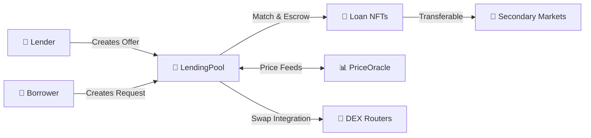

<div align="center">

# 🌊 BaseFi P2P Lending Protocol

### *Your Money. Your Terms. Your Control.*

[](https://getfoundry.sh/)
[](https://opensource.org/licenses/MIT)
[](https://base.org)
[](https://soliditylang.org/)

**[Documentation](./docs/architecture.md)** • **[Security](./SECURITY.md)** • **[Deployment](./docs/deployment.md)**

---

</div>

## 🎯 Why BaseFi?

**The Base network is missing something critical**: a true peer-to-peer lending protocol.

While traditional DeFi pools your assets with strangers and dictates terms, **BaseFi gives you back control**. We saw a gap in the market and built the solution Base deserves—a protocol where:

- 💰 **Your capital stays yours** until the exact moment you choose to lend it
- 🤝 **You negotiate directly** with your counterparty, no intermediaries
- 🎨 **Every loan is an NFT** that you can trade, transfer, or hold
- ⚡ **Speed meets security** on Base's L2 infrastructure

<div align="center">

### 🚀 Built for the Base Ecosystem

*Leveraging Base's low fees and lightning-fast finality to make P2P lending accessible to everyone*

</div>

---

## ✨ What Makes BaseFi Different?

<table>
<tr>
<td width="33%" valign="top">

### 🎯 True P2P Matching
No liquidity pools. No shared risk. Direct lender-to-borrower matching with full transparency and customizable terms.

</td>
<td width="33%" valign="top">

### 🎨 NFT-Based Positions
Every loan mints two ERC-721 NFTs—one for the lender, one for the borrower. Trade your positions or use them as collateral elsewhere.

</td>
<td width="33%" valign="top">

### 🛡️ Enterprise-Grade Safety
Built with pausability, oracle staleness guards, router whitelists, and optional collateral validation. Security first, always.

</td>
</tr>
</table>

---

## 🏗️ Architecture Overview



### Core Components

| Contract | Purpose | Key Features |
|----------|---------|--------------|
| **LendingPool** | Core protocol logic | Offer/request matching, escrow, interest calculation, liquidation |
| **LoanPositionNFT** | Position tokenization | ERC-721 with role-based minting, transferable claims |
| **PriceOracle** | Asset valuation | Chainlink integration, staleness protection, normalized pricing |
| **BaseP2P** | Safe token handling | SafeERC20 wrappers, fee-on-transfer detection |

---

## 🎮 How It Works

<div align="center">

```
┌─────────────┐         ┌──────────────┐         ┌─────────────┐
│   Lender    │         │ LendingPool  │         │  Borrower   │
│   Creates   │────────▶│   Escrows    │◀────────│   Creates   │
│   Offer     │         │     Funds    │         │   Request   │
└─────────────┘         └──────────────┘         └─────────────┘
                               │
                               │ Match
                               ▼
                        ┌──────────────┐
                        │  Mint NFTs   │
                        │ Transfer $   │
                        └──────────────┘
                               │
                    ┌──────────┴──────────┐
                    ▼                     ▼
            ┌──────────────┐      ┌──────────────┐
            │ Lender NFT   │      │ Borrower NFT │
            │ (Position)   │      │ (Position)   │
            └──────────────┘      └──────────────┘
```

</div>

### The Lifecycle

1. **📝 Create** — Lenders post offers with terms; borrowers post requests with collateral
2. **🤝 Match** — Either party accepts the other's terms, creating an atomic loan
3. **🎨 Mint** — Two NFTs are minted representing lender and borrower positions
4. **💸 Repay** — Borrower repays with interest; collateral returned, NFTs burned
5. **⚡ Liquidate** — Expired or undercollateralized loans can be liquidated by lenders

---

## 🔥 Key Features

### 💎 For Lenders
- ✅ Set your own interest rates and loan terms
- ✅ Choose which collateral assets you accept
- ✅ Receive a tradeable NFT representing your claim
- ✅ Liquidate undercollateralized or expired loans
- ✅ Swap liquidated collateral in one transaction

### 🎯 For Borrowers
- ✅ Access capital without selling your assets
- ✅ Browse offers and choose the best rates
- ✅ Repay with any token via integrated DEX swaps
- ✅ Transfer your loan obligation with NFTs
- ✅ No hidden fees or surprise terms

### 🛡️ For Everyone
- ✅ **Pausable** — Emergency pause to protect users
- ✅ **Oracle Guards** — Staleness checks prevent price manipulation
- ✅ **Router Whitelist** — Only trusted DEX routers allowed
- ✅ **Optional Collateral Validation** — Enforce minimum collateral ratios
- ✅ **No Fee-on-Transfer Tokens** — Protection against escrowing issues

---

## 🚀 Quick Start

### Prerequisites

- [Foundry](https://getfoundry.sh/) installed
- Modern Solidity development environment

### Installation & Testing

```bash
# Clone the repository
git clone https://github.com/0xJayOnchain/BaseFi-P2P-Lending-Protocol.git
cd BaseFi-P2P-Lending-Protocol

# Install dependencies
forge install

# Run the test suite
forge test -vv

# Build contracts
forge build

# Run specific test with verbose output
forge test --match-test testMatchingFlow -vvv
```

### Project Structure

```
src/
├── LendingPool.sol          # Core protocol logic
├── LoanPositionNFT.sol      # ERC-721 position tokens
├── PriceOracle.sol          # Asset pricing with staleness guard
├── BaseP2P.sol              # Safe transfer utilities
└── mocks/                   # Testing utilities

test/
├── Matching.t.sol           # Core matching flows
├── Liquidation.t.sol        # Liquidation scenarios
├── RepayWithSwap.t.sol      # DEX integration tests
└── ...                      # Comprehensive test suite

docs/
├── architecture.md          # System design & diagrams
├── security.md              # Threat model & invariants
└── deployment.md            # Deployment guide
```

---

### 🔀 Swap Integration

Repay or liquidate using **any token** via integrated DEX routing:

```solidity
// Borrower repays using WETH instead of USDC
pool.repayFullWithSwap(
    loanId,
    uniswapRouter,
    amountIn,
    [WETH, USDC],  // Swap path
    minUSDCOut,
    deadline
);
```

**Key Benefits:**
- No need to hold exact repayment token
- Slippage protection built-in
- Router whitelist prevents malicious contracts
- Gas-efficient single transaction

### 🎨 NFT Position Trading

Loan positions are **fully transferable ERC-721 tokens**:

- **Lenders** can sell their claim to future interest payments
- **Borrowers** can transfer loan obligations
- **DeFi composability** — use positions as collateral elsewhere
- **Secondary markets** can emerge organically

### 🔐 Security Layers

```
┌─────────────────────────────────────────┐
│         Security Architecture           │
├─────────────────────────────────────────┤
│  ✓ ReentrancyGuard on all state changes│
│  ✓ Pausable emergency stop mechanism   │
│  ✓ SafeERC20 for token interactions    │
│  ✓ Oracle staleness validation         │
│  ✓ Router whitelist enforcement        │
│  ✓ Role-based access control           │
│  ✓ Fee-on-transfer detection           │
└─────────────────────────────────────────┘
```

---

## 🌐 Deployed Contracts

### Base Sepolia (Testnet)

| Contract | Address |
|----------|---------|
| **PriceOracle** | [`0x428EeAD1456C43EaA2BfF10E71509f2cCbAA5fFf`](https://sepolia.basescan.org/address/0x428EeAD1456C43EaA2BfF10E71509f2cCbAA5fFf) |
| **LoanPositionNFT** | [`0x950E723c8C75F925e5DB0aE388371621634920d0`](https://sepolia.basescan.org/address/0x950E723c8C75F925e5DB0aE388371621634920d0) |
| **LendingPool** | [`0xE5cEdb79960ea461D778A130Da9cD279CD575331`](https://sepolia.basescan.org/address/0xE5cEdb79960ea461D778A130Da9cD279CD575331) |

**NFT Collection:** "BaseFi Loan Position" (BFI-LP)

> 🔜 **Base Mainnet deployment coming soon after security audit**

---

## 📚 Documentation

- **[Architecture Guide](./docs/architecture.md)** — System design and flow diagrams
- **[Security Model](./SECURITY.md)** — Threat analysis and safety mechanisms
- **[Deployment Guide](./docs/deployment.md)** — Environment configuration
- **[Governance](./docs/governance.md)** — Admin controls and procedures
- **[Integration Guide](./docs/integrations.md)** — SDK and API documentation
- **[Metrics & Analytics](./docs/metrics.md)** — Indexing and frontend support

---

## 🧪 Test Coverage

Our comprehensive test suite covers:

| Test Suite | Coverage |
|------------|----------|
| Core Matching | ✅ Offer/request creation, cancellation, matching |
| Loan Lifecycle | ✅ Interest accrual, repayment, NFT burning |
| Liquidation | ✅ Expiry, undercollateralization, oracle validation |
| DEX Integration | ✅ Swap repay, swap liquidation, router whitelist |
| Edge Cases | ✅ Pausability, staleness, non-standard tokens |
| Security | ✅ Reentrancy, access control, fee validation |

```bash
# Run full test suite with gas reporting
forge test --gas-report

# Run coverage analysis
forge coverage

# Run specific test category
forge test --match-path test/Matching.t.sol -vvv
```

---

## 🔧 Technical Details

### Compatibility

- ✅ **Standard ERC20 tokens** — Full support via SafeERC20
- ✅ **Non-standard tokens** — Handles unusual decimals and missing return values
- ❌ **Fee-on-transfer tokens** — Currently unsupported (requires exact escrow amounts)

### Swap Integration (Optional Flows)

**Repay with Swap:**
```solidity
repayFullWithSwap(
    uint256 loanId, 
    address router, 
    uint256 amountIn, 
    address[] path, 
    uint256 amountOutMin, 
    uint256 deadline
)
```
- Router must be whitelisted
- Path must end with loan's lend token
- Slippage protection via `amountOutMin`
- Only borrower can call

**Liquidate with Swap:**
```solidity
liquidateWithSwap(
    uint256 loanId, 
    address router, 
    address[] path, 
    uint256 amountOutMin, 
    uint256 deadline
)
```
- Only lender/NFT owner can call
- Converts collateral to lend token in one transaction
- Oracle validation when collateral checks enabled

### Batch Fee Claims

```solidity
claimOwnerFeesBatch(address[] tokens)
```
- Claim multiple token fees in one transaction
- Emits individual and summary events
- Skips tokens with zero fees

---

## 🛣️ Roadmap

### ✅ Phase 1: Core Protocol (Complete)
- [x] P2P matching engine
- [x] NFT position system
- [x] Interest & liquidation logic
- [x] Comprehensive test suite

### ✅ Phase 2: Safety & Integration (Complete)
- [x] Pausability & emergency controls
- [x] Oracle integration with staleness guard
- [x] DEX swap integration
- [x] Router whitelist system
- [x] Collateral validation

### 🔄 Phase 3: Audit & Launch (In Progress)
- [ ] Professional security audit
- [ ] Bug bounty program
- [ ] Base mainnet deployment
- [ ] Frontend dApp launch

### 🔮 Phase 4: Advanced Features (Planned)
- [ ] Multi-signature governance
- [ ] Advanced liquidation strategies
- [ ] Cross-chain lending (via bridges)
- [ ] Mobile app integration

---

## 🤝 Contributing

We welcome contributions! This protocol is built for the Base community, by the Base community.

### Ways to Contribute
- 🐛 **Report bugs** — Open an issue
- 💡 **Suggest features** — Start a discussion
- 🔧 **Submit PRs** — Improve the code
- 📖 **Improve docs** — Help others understand
- 🧪 **Write tests** — Increase coverage

### Development Guidelines

```bash
# Before submitting a PR:
forge test           # All tests must pass
forge fmt            # Format code
forge build          # Must compile without warnings
```

---

## ⚠️ Security

Security is our top priority. We implement multiple layers of protection:

- **Smart Contract Best Practices** — OpenZeppelin, ReentrancyGuard, SafeERC20
- **Oracle Security** — Staleness checks, price validation
- **Access Controls** — Role-based permissions, owner-only functions
- **Emergency Procedures** — Pausable pattern for incident response

### Audit Status

🔍 **Currently under internal review** — Professional audit scheduled before mainnet deployment

### Report Vulnerabilities

Found a security issue? Please report responsibly:

- **Email:** security@basefi.xyz
- **GitHub:** [Create a private security advisory](https://github.com/0xJayOnchain/BaseFi-P2P-Lending-Protocol/security/advisories/new)

**🏆 Bug Bounty Program coming soon!**

---

## 📄 License

This project is licensed under the **MIT License** — see the [LICENSE](./LICENSE) file for details.

---

## 🙏 Acknowledgments

Built with ❤️ for the Base ecosystem using:
- [Foundry](https://getfoundry.sh/) — Blazing fast Ethereum development
- [OpenZeppelin](https://openzeppelin.com/) — Secure smart contract libraries
- [Chainlink](https://chain.link/) — Decentralized oracle network
- [Base](https://base.org) — Ethereum L2 for the next billion users

---

<div align="center">

### 🌊 Join the BaseFi Revolution

**Stop letting protocols control your money. Take back control with BaseFi.**

OFFICALL LINKS TBD

[](https://twitter.com/BaseFiProtocolSocial)
[](https://discord.gg/basefiSocial)
[](https://t.me/basefiSocial)

**[Website](https://basefi.xyzSocial)** • **[App](https://app.basefi.xyzSocial)** • **[Docs](./docs/)** • **[Twitter](https://twitter.com/BaseFiProtocolSocial)**

---

*Made with 💙 on Base*

</div>
